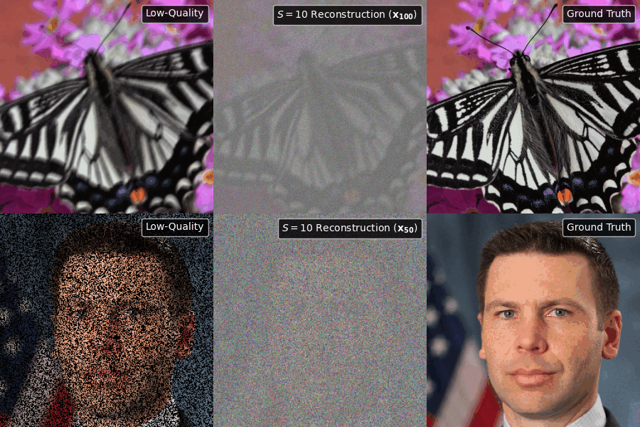

# <span style="color: orange">RDIM</span>

Official repository of Residual Diffusion Implicit Model (RDIM), a diffusion model tailored for inverse problems. 



<hr style="border:2px solid orange">

# <span style="color: orange">Citation</span>

If you find this project useful, please consider citing the paper:
```
@article{
...
}
```

<hr style="border:2px solid orange">

# <span style="color: orange">Quick Inference</span>

<details>
<summary>&nbsp;Run the following code to conduct 2D image reconstruction.</summary>
<br>

   ```python
   import torch
   import torch.nn as nn
   
   # Avoid HTTP Error 403
   torch.hub._validate_not_a_forked_repo = lambda a, b, c: True
   
   # Define device
   device = torch.device("cuda" if torch.cuda.is_available() else ("mps" if torch.mps.is_available() else "cpu"))
   
   # Load models (check pretrained_models/README.md)
   gaussian_diffusion, noise_predictor, lr_encoder = torch.hub.load(
      'joaolcguerreiro/RDIM:main', 'load_model',
      checkpoint_url='???', pretrained=True,
      gaussian_diffusion_kwargs={'num_sampling_timesteps': 1},
      noise_predictor_kwargs={},
      lr_encoder_kwargs={}
   )
   gaussian_diffusion.to(device)
   noise_predictor.to(device)
   lr_encoder.to(device) if lr_encoder else None
   
   # Use multiple GPUs if available
   if torch.cuda.device_count() > 1 or torch.mps.device_count() > 1:
      noise_predictor = nn.DataParallel(noise_predictor, device_ids=None)
      lr_encoder = nn.DataParallel(lr_encoder, device_ids=None) if lr_encoder else None
   
   # Set models to evaluation mode
   noise_predictor.eval()
   lr_encoder.eval() if lr_encoder else None
   
   # (Optional) Set inference patch size (H, W)
   patch_size = (64, 64)
   
   # (Optional) Define inferer
   inferer = torch.hub.load(
      'joaolcguerreiro/RDIM:main', 'load_inferer',
      roi_size=patch_size, scale_factor=gaussian_diffusion.scale_factor, overlap=0.125, mode='gaussian', sw_batch_size=16, sw_device=device, device=device
   )
   
   # Define LQ images to be reconstructed. Mean is 0 and STD is 1.
   # For simplicity, 2 random images with 3 channels and size of 256x256 (H, W) are sampled. Replace them with your images.
   images = torch.randn(2, 3, 256, 256).to(device)
   
   # Generated images. Model expects z-score normalized input images.
   gen_images = gaussian_diffusion.sample(images, noise_predictor, lr_encoder, inferer)
   ```
</details>

<details>
<summary>&nbsp;Run the following code to conduct 3D image reconstruction.</summary>
<br>

   ```python
   import torch
   import torch.nn as nn
   
   # Avoid HTTP Error 403
   torch.hub._validate_not_a_forked_repo = lambda a, b, c: True
   
   # Define device
   device = torch.device("cuda" if torch.cuda.is_available() else ("mps" if torch.mps.is_available() else "cpu"))
   
   # Load models (check pretrained_models/README.md)
   gaussian_diffusion, noise_predictor, lr_encoder = torch.hub.load(
      'joaolcguerreiro/RDIM:main', 'load_model',
      checkpoint_url='???', pretrained=True,
      gaussian_diffusion_kwargs={'num_sampling_timesteps': 1},
      noise_predictor_kwargs={},
      lr_encoder_kwargs={}
   )
   gaussian_diffusion.to(device)
   noise_predictor.to(device)
   lr_encoder.to(device) if lr_encoder else None
   
   # Use multiple GPUs if available
   if torch.cuda.device_count() > 1 or torch.mps.device_count() > 1:
      noise_predictor = nn.DataParallel(noise_predictor, device_ids=None)
      lr_encoder = nn.DataParallel(lr_encoder, device_ids=None) if lr_encoder else None
   
   # Set models to evaluation mode
   noise_predictor.eval()
   lr_encoder.eval() if lr_encoder else None
   
   # (Optional) Set inference patch size (D, H, W)
   patch_size = (32, 32, 32)
   
   # (Optional) Define inferer
   inferer = torch.hub.load(
      'joaolcguerreiro/RDIM:main', 'load_inferer',
      roi_size=patch_size, scale_factor=gaussian_diffusion.scale_factor, overlap=0.125, mode='gaussian', sw_batch_size=16, sw_device=device, device=device
   )
   
   # Define LQ volumes to be reconstructed. Mean is 0 and STD is 1.
   # For simplicity, 2 random volumes with 1 channel and size of 128x128x128 (D, H, W) are sampled. Replace them with your volumes.
   volumes = torch.randn(2, 1, 128, 128, 128).to(device)
   
   # Generated volumes. Model expects z-score normalized input volumes.
   gen_volumes = gaussian_diffusion.sample(volumes, noise_predictor, lr_encoder, inferer)
   ```
</details>

<hr style="border:2px solid orange">

# <span style="color: orange">Usage</span>

### Setup Environment

1) Clone GitHub repository:

   ```
   git clone https://github.com/joaolcguerreiro/RDIM.git
   cd RDIM
   ```

2) Create environment:
   ```
   conda create -n rdim python=3.10.11
   conda activate rdim
   ```

3) Install Python dependencies (Python 3.10 is recommended):
   ```
   pip install -r requirements.txt
   ```

<hr style="border:1px solid gray">

### Prepare Data

1) See [data/README.md](data/README.md) for details.

2) After preparing the data, navigate to `configs/config.yaml` and adjust data paths.

<hr style="border:1px solid gray">

### Train

1) Navigate to `configs/config.yaml` and adjust configuration parameters needed. For example configurations see [configs/examples](configs/examples).

2) Navigate to `src/scripts/`.

3) Run script:
   ```
   python train.py
   ```

> Note: Validation is optional. Use option `--val=True` if validation is intended.

> Note: Set `LR_PATCH_SIZE` in `config.yaml` file for patch-based training (recommended). Patch-based training is not employed when `LR_PATCH_SIZE=[-1, -1, -1]` (more computationally expensive).

<hr style="border:1px solid gray">

### Load Pre-trained

1) See [pretrained_models/README.md](pretrained_models/README.md) to download available pre-trained models or use checkpoint path from a previous experiment.

2) Navigate to `configs/config.yaml` and update `PRE_TRAINED_PATH` parameters.

3) Navigate to `src/scripts/`.

4) Run script:
   ```
   python train.py
   ```

<hr style="border:1px solid gray">

### Resume Train

1) Navigate to `experiments/` and copy experiment path.

2) Navigate to `src/scripts/`.

3) Run script:
   ```
   python train.py --resume=<experiment_path>
   ```

> Note: Load pre-trained differs from resume training since in pre-training only the model weights are loaded and the training is reset. If you resume training the last epoch checkpoint weights will be prioritized over the pre-trained weights.

<hr style="border:1px solid gray">

### Test

1) Navigate to `experiments/` and copy experiment path.

2) Navigate to `src/scripts/`.

3) Run script:
   ```
   python test.py --exp=<experiment_path> --epoch=<epoch> [--lr-patch-size=<lr_patch_size>]
   ```

> Note: Results are in `<experiment_path>/results`. Additionally, check `<experiment_path>/logs/test` and `<experiment_path>/figures/test` for more insights.

> Note: Increase testing `PATCH_SLIDING_WINDOW_BATCH_SIZE` in `config.yaml` file to accelerate testing time. It controls the number of concurrent sliding window patches being processed. Notice, this will also increase memory used.

> Note: Set `--lr-patch-size` to override the training low-resolution patch size.

<hr style="border:1px solid gray">

### Inference

1) Get model checkpoint path.

2) Navigate to `src/scripts/`.

3) Run script:
   ```
    python inference.py --checkpoint=<path_to_checkpoint> --lr-dir=<path_to_lr_dir> --save-dir=<path_to_save_dir> [--batch-size=<batch_size>] [--patch-sliding-window-batch-size=<patch_sliding_window_batch_size>] [--lr-patch-size=<lr_patch_size>]
   ```

> Note: Increase `--patch-sliding-window-batch-size` to accelerate inference time. It controls the number of concurrent sliding window patches being processed. Notice, this will also increase memory used.

> Note: Set `--lr-patch-size` to override the training low-resolution patch size.

<hr style="border:1px solid gray">

### Experiment Tracking

Everytime you train a model, an experiment folder is built (unless training is resumed, in which case the folder from the prior run is used). The configuration file for the execution is stored in the experiment folder, allowing the original parameters to be retrieved when resuming training.

See [experiments/README.md](experiments/README.md) for details.

<hr style="border:2px solid orange">

# <span style="color: orange">License</span>

This project is licensed under MIT license. See [LICENSE](LICENSE) for details.
